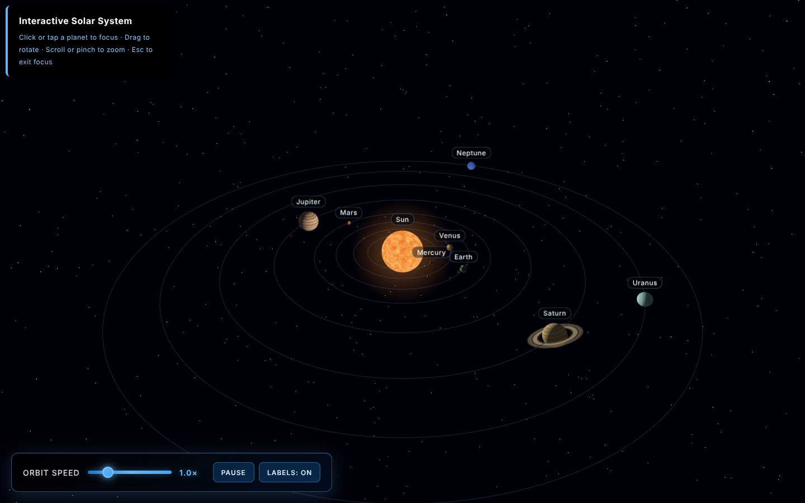
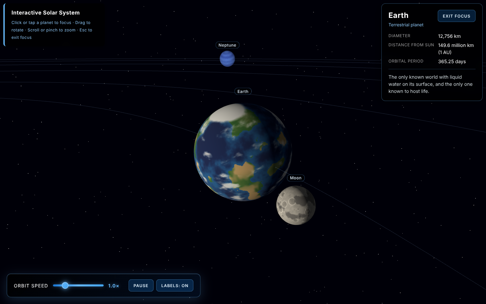

# Solar System 3D

An interactive 3D model of the Solar System that runs in the browser, built with Three.js and plain JavaScript modules. It shows the Sun, all eight planets, Earth's Moon and Saturn's rings. You can click any body to fly to it, follow it along its orbit and read a few facts about it.

Sizes and distances are scaled so everything fits on screen (true scale would make most planets invisible). Orbital speeds use the real orbital periods, so the planets move at correct speeds relative to each other.

**Live demo:** https://besnikemini5.github.io/solar-system-3d/



## Features

- Sun, Mercury, Venus, Earth (with the Moon), Mars, Jupiter, Saturn (with rings), Uranus and Neptune, in the right order
- Relative orbit speeds based on real orbital periods, plus axial tilts (Uranus spins on its side, Venus spins backwards)
- Click or tap a body to fly to it; the camera then follows it smoothly while it orbits
- Info panel with name, type, diameter, distance from the Sun, orbital period and a short fact
- Planet name labels that can be toggled on/off (labels are also clickable)
- Orbit speed slider (0–5×) and a pause button
- Responsive layout that works on phones with touch controls
- Procedural textures generated with a seeded random generator, so they look the same on every load
- No network requests at runtime: Three.js is vendored and there are no image files to download

## Controls

| Action | Mouse / keyboard | Touch |
| --- | --- | --- |
| Rotate view | Left-drag | One-finger drag |
| Zoom | Scroll wheel | Pinch |
| Pan | Right-drag | Two-finger drag |
| Focus a body | Click it or its label | Tap it or its label |
| Exit focus | `Esc` or the **Exit focus** button | **Exit focus** button |
| Pause / play | `Space` or the **Pause** button | **Pause** button |

## Tech

- [Three.js](https://threejs.org/) r158 (`three.module.js` and `OrbitControls`), vendored in `vendor/three/`
- Vanilla JavaScript (ES modules), HTML and CSS
- No build step and no dependencies to install

## Run locally

ES modules don't load from `file://`, so serve the folder with any static server:

```bash
git clone https://github.com/besnikemini5/solar-system-3d.git
cd solar-system-3d
python -m http.server 8000
```

Then open http://localhost:8000.

## Deploy on GitHub Pages

1. Push the project to a repository named `solar-system-3d`.
2. On GitHub go to **Settings → Pages**.
3. Under **Build and deployment**, set **Source** to *Deploy from a branch*, pick the `main` branch and the `/ (root)` folder, then **Save**.
4. After a minute or two the site is live at `https://<username>.github.io/solar-system-3d/`.

All paths in the project are relative, so it works from a subfolder like that without changes.

## How it's built

```
index.html          page layout and UI markup
styles/style.css    UI styling and mobile layout
src/main.js         entry point, wires everything together and handles the UI
src/scene.js        scene and renderer
src/camera.js       camera, OrbitControls and the overview position
src/lights.js       ambient light + point light at the Sun
src/planetData.js   sizes, distances, periods, tilts and info panel text
src/textures.js     seeded procedural textures (planets, rings, Sun glow)
src/planets.js      builds the bodies, orbit lines, rings and starfield
src/interaction.js  picking, fly-to, follow and exit focus
src/labels.js       HTML labels projected from 3D positions
src/animate.js      render loop (orbits, spin, camera, labels)
vendor/three/       pinned copy of Three.js r158
```

Each planet sits in a small hierarchy: an orbit group that rotates around the Sun, an anchor at the orbit distance, a tilt group for the axial tilt, and the mesh that spins. The Moon's orbit group is attached to Earth's anchor, so it orbits Earth while Earth orbits the Sun. The Moon has no separate spin, so like the real one it always shows the same side to Earth.

When you focus a body, the camera uses the body's world position (`getWorldPosition()`), not its local position inside the orbit group. Every frame the camera is carried along with the body and rotated by the angle the body moved around the Sun, so the view stays steady while you can still rotate and zoom around it.

Textures are drawn on a canvas at startup. Each pixel is sampled from 3D value noise on the unit sphere, which avoids seams and stretched poles. The noise uses a fixed seed, so the result is identical on every load.

## Texture credits and licenses

All planet, ring, Sun and star textures are generated in code by `src/textures.js` (part of this project). No third-party image files are used.

Three.js is © 2010–2023 Three.js Authors, released under the MIT License. A copy of its license is in `vendor/three/LICENSE`.

Planet facts and figures are rounded values from NASA's planetary fact sheets.

## Screenshots

Overview:


Focused on Earth, with the info panel:


